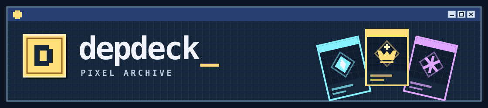
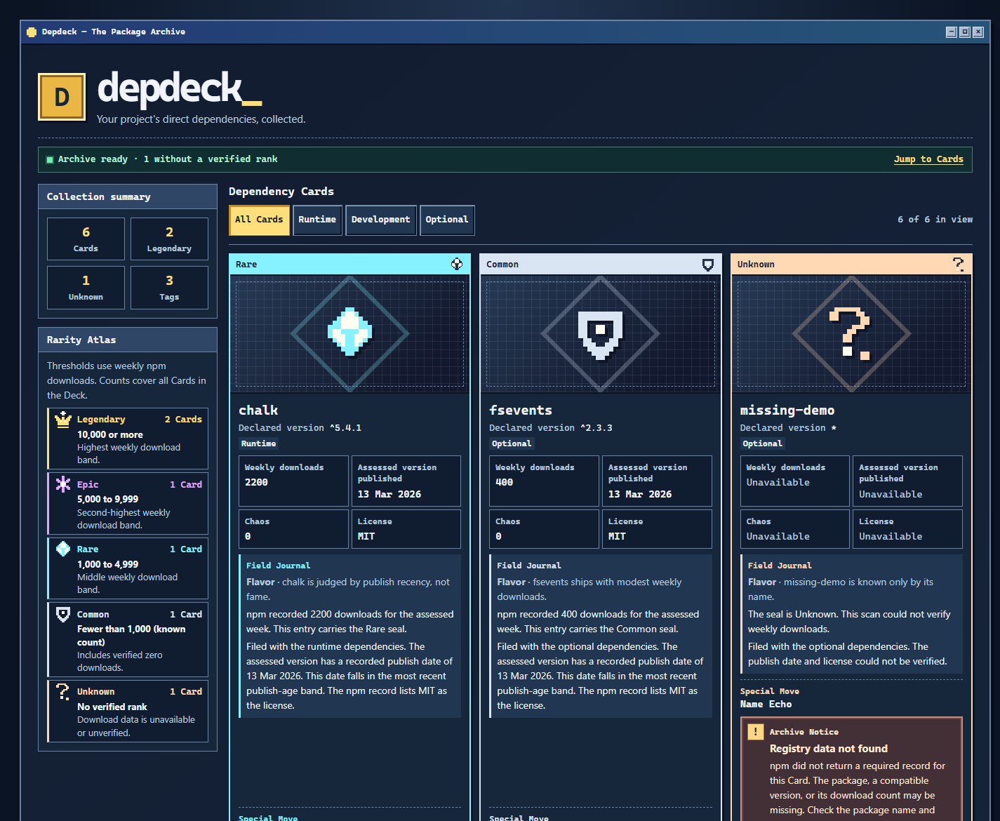
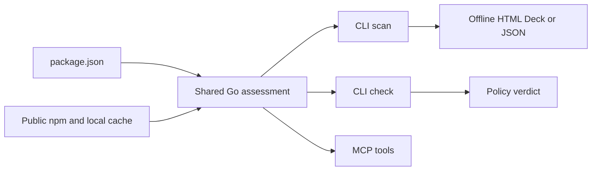

# depdeck

**Give your dependencies a card catalog.** Depdeck turns the packages your project declares for npm, the JavaScript package registry into a retro trading-card Deck. Browse the cards offline, check a few project rules in automated builds, or let your coding agent read the same assessment.

[](https://github.com/pragatikumari0927/depdeck/releases) [](https://github.com/pragatikumari0927/depdeck/actions/workflows/test.yml?query=branch%3Amain) [](LICENSE)



The screenshot comes from the Go CLI and a seeded offline fixture. Its download counts and dates are sample data. [Mobile screenshot and verification results](docs/TESTING.md#pixel-archive-verification)

## What goes into a Deck?

`package.json` is the file where a JavaScript project declares its name, scripts, and dependencies. Each dependency entry names a package and usually specifies a version range. Depdeck reads the runtime, development, and optional entries in the root file. A package listed there is a *direct dependency*.

## Quickstart

Build from this checkout to try the Pixel Archive shown above. Use Go 1.26.9 or later and add Go’s binary directory to `PATH`, the list of places your shell looks for commands. Use the directory from `go env GOBIN` if set. Otherwise, use the `bin` folder under `go env GOPATH`.

```sh
go install ./cmd/depdeck
depdeck --version
```

In a project directory that contains `package.json`, run:

```sh
depdeck scan
```

Open `deck.html` beside `package.json` in your browser. The scan reads public npm facts as needed. The generated file has everything it needs to open offline.

### Install the published version

The release and Homebrew commands below install the published build. The screenshots above show the Pixel Archive feature branch.

- Download the archive for Windows, macOS, or Linux and your CPU architecture (`amd64` or `arm64`). Compare its SHA-256 checksum with the matching entry in `checksums.txt`, then put the extracted executable on `PATH`. [GitHub Releases](https://github.com/pragatikumari0927/depdeck/releases)
- On macOS, use `brew install pragatikumari0927/tap/depdeck`. [Homebrew tap](https://github.com/pragatikumari0927/homebrew-tap)
- With Go, run `go install github.com/pragatikumari0927/depdeck/cmd/depdeck@v1.0.0`.

## Read the Cards

Each Card shows the declared version, dependency group, weekly npm downloads, publish date, Chaos, and license when those facts are available. **Chaos** summarizes publish recency. The **Field Journal** puts the facts into plain English. Rule-based **Flavor** and **Special Move** add a little personality.

The Rarity seal comes from the assessed weekly download count.

| Seal | Weekly npm downloads |
| --- | ---: |
| Legendary | 10,000 or more |
| Epic | 5,000–9,999 |
| Rare | 1,000–4,999 |
| Common | 0–999, with a known count |
| Unknown | No verified rank |

The Rarity Atlas counts the whole Deck. Tag filters change the Cards in view. A failed lookup keeps its Card in the Deck with an Archive Notice and unavailable fields.

## CLI examples

Run these in your project directory. An optional path can point to a project directory or its `package.json`. Put flags before the path.

```sh
depdeck scan --out ./dependencies.html .
depdeck scan --flavor none .
depdeck scan --json .
depdeck check --json .
```

`--flavor none` skips Flavor and Special Move. `--json` writes the assessment to standard output. Both commands support `--no-cache` to skip the local cache. With `jq` installed, you can list Legendary packages from the JSON.

```sh
depdeck scan --json . | jq '.data.dependencies[] | select(.rarity == "Legendary") | .name'
```

By default, `check` flags assessed dependencies when Chaos exceeds 0.5 or the license is missing. Degraded Cards carry fetch errors for review. In CI (continuous integration), run `depdeck check` directly to use its exit status.

| Exit | Meaning |
| --- | --- |
| `0` | Scan succeeded or Check passed |
| `1` | Check flagged at least one dependency |
| `2` | Invalid input, usage, or a local error |
| `3` | Every fetch failed in a nonempty Check |

## Connect a coding agent

MCP stands for Model Context Protocol. It lets a compatible coding agent call Depdeck as a local tool. For clients that use an `mcpServers` configuration, add:

```json
{
  "mcpServers": {
    "depdeck": {
      "command": "depdeck",
      "args": ["mcp"]
    }
  }
}
```

Use the absolute executable path if the client cannot find `depdeck`. Use an absolute project path when the client starts the server in a different directory. MCP communicates over standard input and output.

| Tool | Arguments | Result |
| --- | --- | --- |
| `list_deck` | `path`, optional `tag` and `flavor` | Cards for a project |
| `get_card` | npm package `name`, optional `flavor` | One registry Card |
| `check_deck` | `path` | Policy verdict and assessed dependencies |

The CLI and MCP share the JSON envelope with schema `1.1`. Consumers check the major version and read `data` according to the operation. [Output contract](docs/SPEC.md#envelope)

### Prompts to try

- “Use `list_deck` on this project with `tag: devDependencies`. Summarize the publish dates and point out missing registry facts.”
- “Use `get_card` for `react`. Give me its weekly downloads, Rarity, publish date, and license.”
- “Run `check_deck` for this project. Explain which policy rules fired and list any fetch errors separately.”

## How it works



`get_card` uses npm facts for one package and needs no project manifest.

## Scope

- Depdeck reads direct dependencies from the root manifest. Lockfile resolution, nested workspaces, transitive dependencies, and private registry authentication are outside its scope.
- Rarity describes downloads and Chaos describes publish recency. Vulnerability scanning and license compliance review are separate jobs.
- A scan may need access to public npm. The HTML Deck can be opened and filtered offline.

[Contributing and development](docs/DEVELOPMENT.md) · [Specification](docs/SPEC.md) · [Testing](docs/TESTING.md) · [Security and reporting](docs/SECURITY.md) · [Changelog](CHANGELOG.md)

[MIT license](LICENSE) · [Third-party notices](THIRD_PARTY_NOTICES.txt)
