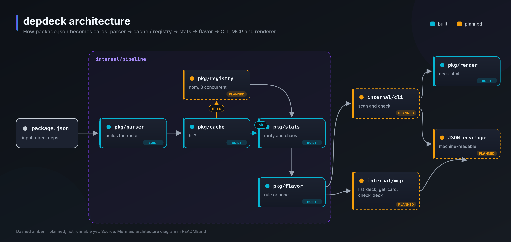
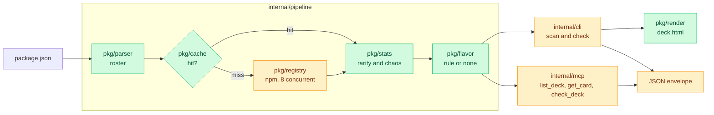
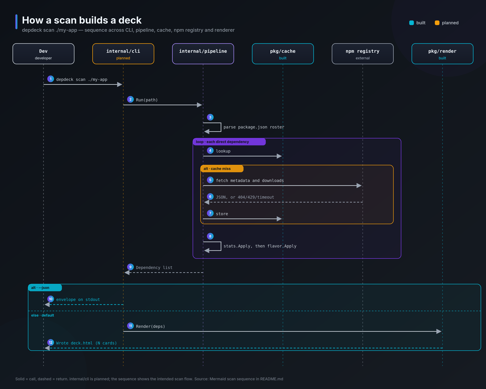
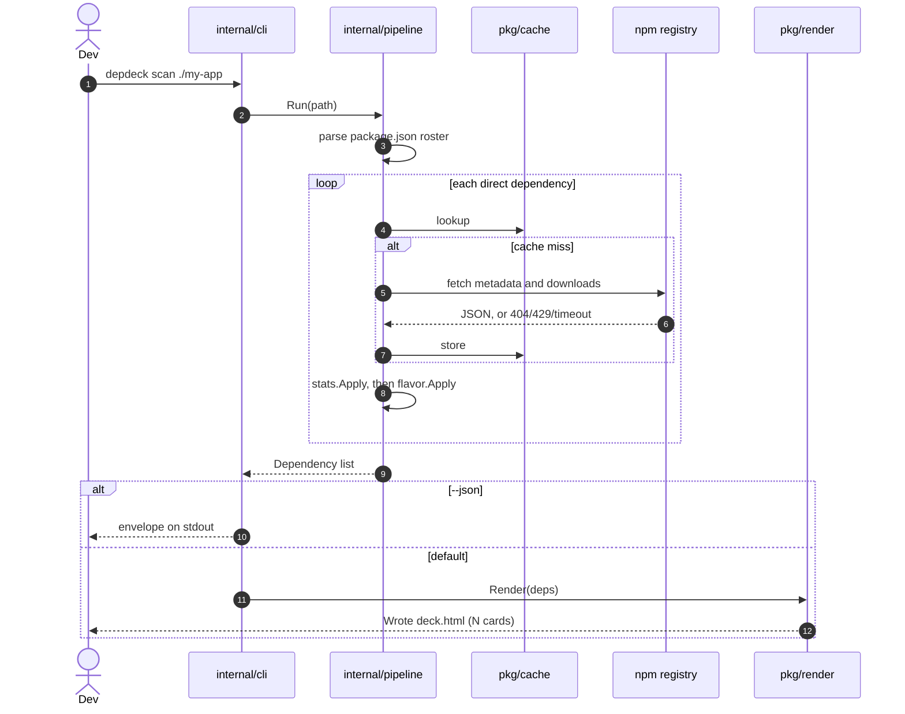
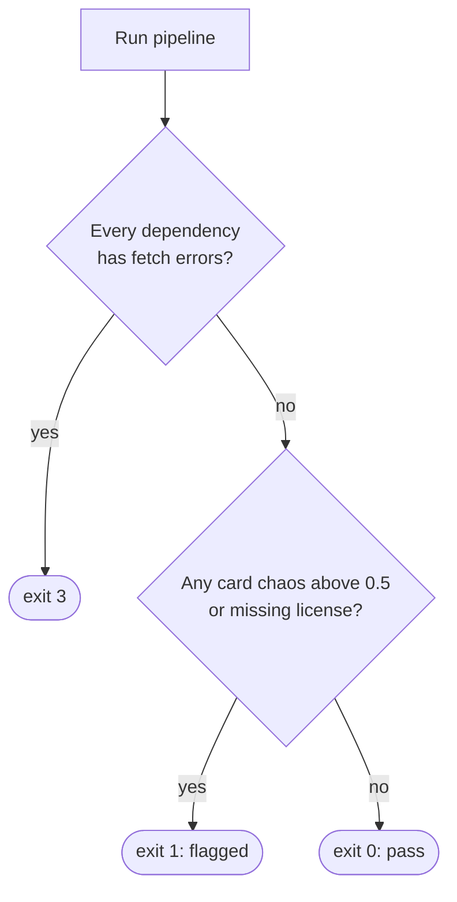
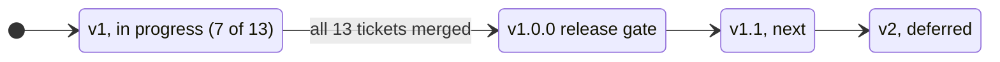

<p align="center"></p>

<a id="readme-top"></a>

<div align="center">

# 🃏 depdeck

**Your `package.json`, dealt as a deck of trading cards.**

depdeck turns each direct npm dependency into a card showing rarity, chaos, license and flavor text.<br/>
It renders the deck as a single self-contained `deck.html`, gates CI with `depdeck check`, and serves the same data to AI agents over MCP.

[](go.mod)
[](PHASES.md)
[](.github/workflows/test.yml)
[](SPEC.md)
[](docs/adr/0007-mcp-three-tools.md)
[](#-license)


[**Spec**](SPEC.md) · [**Roadmap**](PHASES.md) · [**Decisions**](DECISIONS.md) · [**Design tokens**](DESIGN.md) · [**ADRs**](docs/adr/)

</div>

> [!WARNING]
> **depdeck is not runnable yet.** v1 is in progress: 7 of 13 tickets are merged. The core packages (`types`, `cache`, `parser`, `stats`, `flavor`, `render`) are built and tested. The npm registry client, pipeline, CLI, MCP server and the `cmd/depdeck` entrypoint have not been written. Commands below marked 🚧 are **planned** and come from [SPEC.md](SPEC.md).

<details>
<summary><b>📑 Table of contents</b></summary>

- [✨ Features](#-features)
- [🏗️ Architecture](#️-architecture)
- [🎴 Anatomy of a card](#-anatomy-of-a-card)
- [🚀 Getting started](#-getting-started)
- [🧭 Usage](#-usage)
- [📂 Project structure](#-project-structure)
- [🗺️ Roadmap](#️-roadmap)
- [🤝 Contributing](#-contributing)
- [📄 License](#-license)

</details>

## ✨ Features

<table>
<tr>
<td width="50%" valign="top">

### 🃏 Deck, not a report
Each direct dependency becomes a card: **Rarity**, **Chaos**, license, last publish and a **Special Move**. All of it fits on one page.

</td>
<td width="50%" valign="top">

### 📦 One self-contained file
`deck.html` embeds its template with `go:embed`. The output is **byte-deterministic** and needs no CDN or JS bundle ([ADR-0006](docs/adr/0006-self-contained-deck-html.md)).

</td>
</tr>
<tr>
<td valign="top">

### ✅ CI gate
`depdeck check` runs the same pipeline and exits `1` when a dependency breaks policy. The default policy is chaos ≤ 0.5 and a license is required ([ADR-0010](docs/adr/0010-check-policy-v1.md)).

</td>
<td valign="top">

### 🤖 MCP server
There are three tools, `list_deck`, `get_card` and `check_deck`, with explicit input schemas ([ADR-0007](docs/adr/0007-mcp-three-tools.md)).

</td>
</tr>
<tr>
<td valign="top">

### 🧱 Degrades gracefully
npm 404, 429 or timeout responses become **degraded cards** with typed `errors`. They never crash the run ([ADR-0003](docs/adr/0003-degraded-cards-and-fetch.md)).

</td>
<td valign="top">

### ⚡ Cached and bounded
An on-disk HTTP cache plus 8 concurrent registry fetches ([ADR-0004](docs/adr/0004-on-disk-http-cache.md)). Tests never touch the live registry.

</td>
</tr>
</table>

<p align="right">(<a href="#readme-top">back to top</a>)</p>

## 🏗️ Architecture

One core pipeline serves both faces: the CLI and MCP ([ADR-0001](docs/adr/0001-two-faces-same-core.md)). `internal/pipeline` never writes to stdout, parses flags or exits.

<p align="center"></p>

<details><summary>Mermaid source</summary>



</details>

<sub>🟩 implemented and tested · 🟧 planned (v1 tickets still open)</sub>

### How a deck gets dealt (`depdeck scan`, planned)

<p align="center"></p>

<details><summary>Mermaid source</summary>



</details>

### `depdeck check` decision (planned)



<p align="right">(<a href="#readme-top">back to top</a>)</p>

## 🎴 Anatomy of a card

Values come straight from `pkg/stats` and `pkg/types`.

| Stat | Rule |
|---|---|
| ⭐ **Rarity** | ≥ 10,000 weekly downloads: **Legendary** · ≥ 5,000: **Epic** · ≥ 1,000: **Rare** · otherwise: **Common** ([ADR-0009](docs/adr/0009-rarity-thresholds.md)) |
| 🌀 **Chaos** | last publish under 2 years ago: `0.0` · 2–5 years: `0.6` · over 5 years or unknown: `1.0` |
| 🏷️ **Tag** | `dependencies`, `devDependencies` or `optionalDependencies` (direct dependencies only, [ADR-0002](docs/adr/0002-directs-only-deck.md)) |
| ✨ **Special Move** | deterministic, rule-based caption ([ADR-0013](docs/adr/0013-add-special-move.md)) |
| ⚠️ **Errors** | `not_found`, `timeout`, `rate_limit`, `network` or `parse`. These blank out the stats instead of guessing them. |

<details>
<summary>JSON envelope (<code>--json</code> / MCP)</summary>

```json
{
  "schema_version": "1.0",
  "generated_at": "<RFC3339 UTC>",
  "generated_by": "depdeck x.y.z",
  "tool": "scan",
  "data": { "dependencies": [ /* Dependency, ... */ ] }
}
```
</details>

<p align="right">(<a href="#readme-top">back to top</a>)</p>

## 🚀 Getting started

**Prerequisite:** Go 1.22 or later.

```bash
git clone https://github.com/pragatikumari0927/depdeck.git
cd depdeck
go vet ./...
go test -race ./...     # ✅ works today, runs on fixtures with no network
```

🚧 *Planned*, once `cmd/depdeck` lands and the module path is renamed:

```bash
go build -o depdeck ./cmd/depdeck
go install github.com/pragatikumari0927/depdeck/cmd/depdeck@latest
```

## 🧭 Usage

> 🚧 Every command in this section is planned (SPEC.md v1 contract). None runs yet.

```bash
depdeck scan ./my-app              # writes ./my-app/deck.html
depdeck scan ./my-app --json       # JSON envelope on stdout, no HTML
depdeck scan . --out -             # HTML to stdout
depdeck scan . --flavor none       # no flavor text
depdeck check . --no-cache         # CI gate
depdeck mcp                        # MCP server for agents
```

| Exit code | Meaning |
|:---:|---|
| `0` | success / check passed |
| `1` | check flagged a dependency |
| `2` | usage error, or `--flavor=ai` (reserved for v1.1) |
| `3` | check: every dependency failed to fetch |

<p align="right">(<a href="#readme-top">back to top</a>)</p>

## 📂 Project structure

```text
depdeck/
├── pkg/
│   ├── types/       ✅ Dependency, FetchError, Envelope, CheckPolicy
│   ├── cache/       ✅ on-disk HTTP cache
│   ├── parser/      ✅ root package.json roster
│   ├── stats/       ✅ rarity, chaos, check flagging
│   ├── flavor/      ✅ rule / none flavor and special moves
│   ├── render/      ✅ deck.html (templates/deck.html via go:embed)
│   └── registry/    🚧 npm client
├── internal/        🚧 pipeline, cli, mcp
├── cmd/depdeck/     🚧 entrypoint (wiring only)
├── testdata/        fixture package.json projects
├── docs/adr/        15 architecture decision records
├── SPEC.md          frozen v1 technical contract
├── DESIGN.md        card and deck design tokens
├── PHASES.md        roadmap and git workflow
└── DECISIONS.md · CONTEXT.md · RULES.md · DEVELOPMENT.md · SECURITY.md
```

## 🗺️ Roadmap



**v1 (current)**
- [x] `pkg/types`, `pkg/cache`, `pkg/parser`, `pkg/stats`, `pkg/flavor`, `pkg/render`
- [ ] `pkg/registry`: npm fetch, cache-aware, 8 concurrent
- [ ] `internal/pipeline`, `internal/cli`, `internal/mcp`
- [ ] `cmd/depdeck` and fixture testdata

**v1.0.0 release gate**
- [ ] Module path renamed to `github.com/pragatikumari0927/depdeck`
- [ ] README demo GIF · GoReleaser (GitHub Release + Homebrew tap) · `CHANGELOG.md` via git-cliff

**v1.1 (next)**
- [ ] `--flavor=ai` via Ollama · PNG card export (chromedp) · `install_size` stat · `depdeck doctor`

**v2 (deferred)**
- [ ] GitHub enrichment · go.mod / Cargo.toml / pyproject parsers · `depdeck battle` · monorepo CI check

<p align="right">(<a href="#readme-top">back to top</a>)</p>

## 🤝 Contributing

1. Read [SPEC.md](SPEC.md) and [DEVELOPMENT.md](DEVELOPMENT.md). Changing a frozen claim means changing its ADR first.
2. Work trunk-based on a branch: `git worktree add ../depdeck-<variant> -b <branch>`
3. Use Conventional Commits, one commit per ticket, and keep PRs under 400 lines.
4. Run `go vet ./... && go test -race ./...` before pushing. CI runs the same checks.

Security reports: see [SECURITY.md](SECURITY.md).

## 📄 License

**TBD.** No license has been chosen yet, so all rights are reserved until one is added.

<p align="right">(<a href="#readme-top">back to top</a>)</p>
