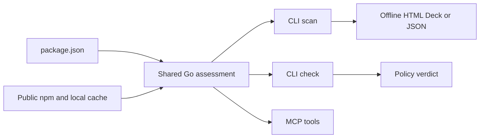
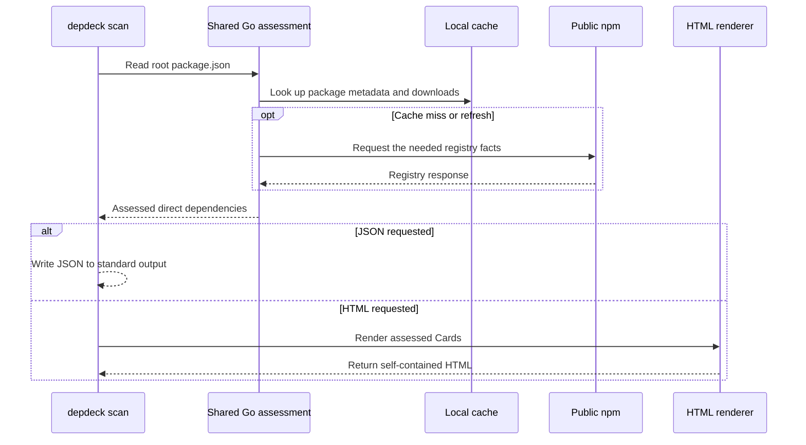

# depdeck

**Your `package.json` has a secret card collection.**

*Gotta scan ’em all.* Depdeck deals the packages your project declares into a pixel-art Deck. Look up npm facts, run a policy Check, or ask a coding agent to read the same assessment.

[](https://github.com/pragatikumari0927/depdeck/releases) [](https://github.com/pragatikumari0927/depdeck/actions/workflows/test.yml?query=branch%3Amain) [](LICENSE)

## Peek inside the Pixel Archive


<details>
<summary>See the mobile Deck</summary>


</details>

**The screenshots show Pixel Archive on `main`. The published `v1.0.0` release has the earlier Card layout.** Both screenshots come from the Go CLI using offline fixtures. The download counts and dates are sample data. [Pixel Archive verification results](docs/TESTING.md#pixel-archive-verification)

## Start your collection

### Install the published v1.0.0 release

- **Prebuilt executable.** Choose the archive for Windows, macOS, or Linux and your CPU architecture (`amd64` or `arm64`). Compare its SHA-256 checksum with the matching line in `checksums.txt`. Extract the executable and put it on your `PATH`, the list of directories your terminal searches for programs. [Release archives](https://github.com/pragatikumari0927/depdeck/releases/tag/v1.0.0) · [Checksums](https://github.com/pragatikumari0927/depdeck/releases/download/v1.0.0/checksums.txt)
- **Homebrew on macOS.** Run `brew install pragatikumari0927/tap/depdeck`. [Homebrew tap](https://github.com/pragatikumari0927/homebrew-tap)
- **Go 1.26.9 or later.** Run `go install github.com/pragatikumari0927/depdeck/cmd/depdeck@v1.0.0`.

For either Go install in this guide, add the directory from `go env GOBIN` to your `PATH`. If that command returns an empty value, use the `bin` directory under `go env GOPATH`. Run `depdeck --version` to check which executable your shell found.

### Open your first Deck

A JavaScript project’s `package.json` lists its scripts and the packages it uses. A package listed in the root file’s runtime, development, or optional group is a *direct dependency*. npm is the public JavaScript package registry that supplies the package facts.

Run this command from the directory that contains your project’s `package.json`.

```sh
depdeck scan
```

Open `deck.html` beside the manifest. A scan can contact public npm. You can open and filter the saved Deck offline.

### Try the Pixel Archive from main

Pixel Archive landed after the `v1.0.0` tag. With Go 1.26.9 or later, build it from the current source.

```sh
git clone https://github.com/pragatikumari0927/depdeck.git
cd depdeck
go install ./cmd/depdeck
```

If you use both builds, install them in separate directories and choose which executable your shell runs.

## Read the Cards

A Card shows the declared version and dependency group, plus the weekly npm downloads, publish date, Chaos, and license when available. **Chaos** scores publish recency. In the Pixel Archive, the **Field Journal** explains the available facts, and rule-based **Flavor** and **Special Moves** add character.

| Rarity seal | Weekly npm downloads |
| --- | --- |
| Legendary | 10,000 or more |
| Epic | 5,000–9,999 |
| Rare | 1,000–4,999 |
| Common | 0–999 |
| Unknown | Download data is unavailable or unverified |

A verified count of zero earns a Common seal. The Rarity Atlas counts the full Deck. The Runtime, Development, and Optional filters change which Cards you see. A failed lookup keeps the Card visible and adds an Archive Notice in the Pixel Archive.

## CLI examples

Run these in your project directory. The optional path can point to a project directory or its `package.json`. Put flags before the path.

```sh
depdeck scan --out ./dependencies.html .
depdeck scan --flavor none .
depdeck scan --json .
depdeck check --json .
```

`--flavor none` omits Flavor and Special Moves. `--json` writes the assessment to standard output and skips HTML generation. Both commands accept `--no-cache` to bypass cache reads and writes. With `jq`, a command-line JSON filter, you can list Legendary package names.

```sh
depdeck scan --json . | jq '.data.dependencies[] | select(.rarity == "Legendary") | .name'
```

By default, `check` flags a Dependency when its Chaos exceeds 0.5 or its license is missing after a successful fetch. A Card with fetch errors keeps those errors for review. In continuous integration (CI), run `depdeck check` directly to use its exit status.

| Exit | Meaning |
| --- | --- |
| `0` | Scan succeeded or Check passed |
| `1` | Check flagged at least one dependency |
| `2` | Invalid input, usage, or a local error |
| `3` | All dependencies in a nonempty Check had fetch errors |

## Connect a coding agent

Model Context Protocol (MCP) lets a compatible coding agent call Depdeck as a local tool. For clients that use an `mcpServers` configuration, use this entry.

```json
{
  "mcpServers": {
    "depdeck": {
      "command": "depdeck",
      "args": ["mcp"]
    }
  }
}
```

The server uses standard input and output. If your client cannot find `depdeck`, set `command` to the absolute executable path. Pass an absolute project path if the client runs the server from another directory.

| Tool | Arguments | Result |
| --- | --- | --- |
| `list_deck` | `path`, optional `tag` and `flavor` | Cards for a project |
| `get_card` | npm package `name`, optional `flavor` | One registry Card |
| `check_deck` | `path` | Policy verdict and assessed dependencies |

Use `rule` or `none` for `flavor`. Valid Tag values are `dependencies`, `devDependencies`, and `optionalDependencies`. CLI and MCP results use the same JSON envelope at schema `1.1`. Check the major version and read `data` according to the operation. For an empty Check, the current implementation omits `data.dependencies`. See the [output contract](docs/SPEC.md#envelope).

### Prompts to try

- “Use `list_deck` for this project with the Tag `devDependencies`. Summarize the publish dates and point out missing npm facts.”
- “Use `get_card` for `react`. Show its weekly downloads, Rarity, publish date, and license.”
- “Run `check_deck` for this project. Explain what triggered each flag and list fetch errors separately.”

## Under the cartridge



`get_card` looks up one npm package directly. It needs no project manifest.

<details>
<summary>Follow a scan from manifest to Deck</summary>



</details>

## Scope and project links

- Depdeck reads direct dependencies from the root manifest. Lockfile resolution, workspace traversal, transitive dependencies, and private registry authentication are outside its scope.
- Rarity measures weekly downloads and Chaos scores publish recency. Use dedicated tools for vulnerability scanning and license compliance.
- License and publish date describe the published version selected for the declared npm range. They can differ from the version installed on your machine.
- Depdeck reads package data without installing dependencies or running package scripts. Use `rule` or `none` for Flavor. `ai` returns an error.

[Development and contributing](docs/DEVELOPMENT.md) · [Documentation map](docs/README.md) · [Specification](docs/SPEC.md) · [Architecture decisions](docs/DECISIONS.md) · [Testing](docs/TESTING.md)

Report suspected vulnerabilities privately through GitHub Security Advisories. [Security reporting guide](docs/SECURITY.md)

[Release notes](RELEASE_NOTES.md) · [Release process](docs/RELEASING.md) · [Changelog](CHANGELOG.md)

[MIT license](LICENSE) · [Third-party notices](THIRD_PARTY_NOTICES.txt)
