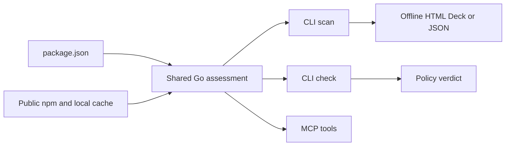
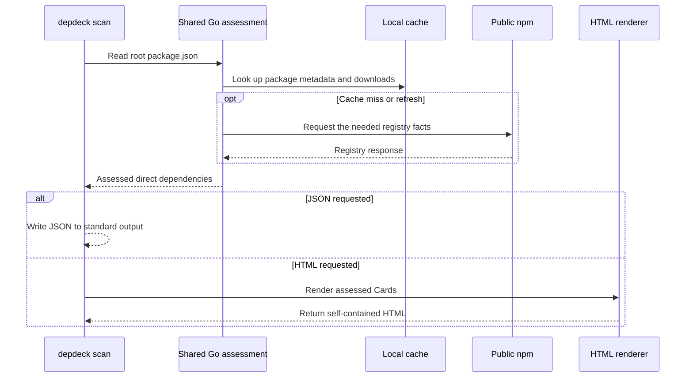

<div align="center">


# depdeck

**Your `package.json` has a secret card collection.**

*Gotta scan ’em all.* Turn the npm packages your project declares into pixel-art Cards. Browse package facts, run a policy Check, or explore the Deck with a coding agent.

[](https://github.com/pragatikumari0927/depdeck/releases) [](https://github.com/pragatikumari0927/depdeck/actions/workflows/test.yml?query=branch%3Amain) [](LICENSE)

</div>

## Peek inside the Pixel Archive


<details>
<summary>See the mobile Deck</summary>


</details>

**This animation shows Pixel Archive on `main`, before package identity artwork was added. The published `v1.0.0` release has the earlier Card layout.** It uses an offline fixture: package names, download counts, and dates are sample data. The filters work, and the Rarity Atlas totals stay fixed as the visible Cards change. [Pixel Archive verification results](docs/TESTING.md#pixel-archive-verification)

## Start your collection

### Install the currently published release (v1.0.0)

- **Prebuilt executable.** Choose the archive for Windows, macOS, or Linux and your CPU architecture (`amd64` or `arm64`). Compare its SHA-256 checksum with the matching line in `checksums.txt`. Extract the executable and put it on your `PATH`, the list of directories your terminal searches for programs. [Release archives](https://github.com/pragatikumari0927/depdeck/releases/tag/v1.0.0) · [Checksums](https://github.com/pragatikumari0927/depdeck/releases/download/v1.0.0/checksums.txt)
- **Homebrew on macOS.** Run `brew install pragatikumari0927/tap/depdeck`. [Homebrew tap](https://github.com/pragatikumari0927/homebrew-tap)
- **Go install.** Use a current security patch for your Go line, such as Go 1.26.11 or Go 1.27.4. Run `go install github.com/pragatikumari0927/depdeck/cmd/depdeck@v1.0.0`.

**v1.1.0 is prepared but not published yet.** After it appears on the
[releases page](https://github.com/pragatikumari0927/depdeck/releases), use its
archives and checksums. On Homebrew, run `brew upgrade depdeck` if it is
already installed, or `brew install pragatikumari0927/tap/depdeck` on a new
machine. With Go, run
`go install github.com/pragatikumari0927/depdeck/cmd/depdeck@v1.1.0`.
Until then, v1.0.0 remains the published build; the Pixel Archive renderer is
available from `main` as described below.

For either Go install in this guide, add the directory from `go env GOBIN` to your `PATH`. If that command returns an empty value, use the `bin` directory under `go env GOPATH`. Run `depdeck --version` to check which executable your shell found.

### Open your first Deck

A JavaScript project’s `package.json` lists its scripts and the packages it uses. A package listed in the root file’s runtime, development, or optional group is a *direct dependency*. npm is the public JavaScript package registry that supplies the package facts.

Run this command from the directory that contains your project’s `package.json`.

```sh
depdeck scan
```

Open `deck.html` beside the manifest. A scan can contact public npm. You can open and filter the saved Deck offline.

### Try the Pixel Archive from main

Pixel Archive landed after the `v1.0.0` tag. Build from the current source with a patched Go toolchain. The minimum is Go 1.26.11.

```sh
git clone https://github.com/pragatikumari0927/depdeck.git
cd depdeck
go install ./cmd/depdeck
```

If you use both builds, install them in separate directories and choose which executable your shell runs.

## Read the Cards

A Card shows the declared version and dependency group, plus the weekly npm downloads, publish date, Chaos, and license when available. **Chaos** scores publish recency. In the Pixel Archive, the **Field Journal** explains the available facts, and rule-based **Flavor** and **Special Moves** add character.

| Rarity seal | Weekly npm downloads |
| --- | --- |
| Legendary | 10,000 or more |
| Epic | 5,000–9,999 |
| Rare | 1,000–4,999 |
| Common | 0–999 |
| Unknown | Download data is unavailable or unverified |

A verified count of zero earns a Common seal. The Rarity Atlas counts the full Deck. The Runtime, Development, and Optional filters change which Cards you see. A failed lookup keeps the Card visible and adds an Archive Notice in the Pixel Archive.

## CLI examples

Run these in your project directory. The optional path can point to a project directory or its `package.json`. Put flags before the path.

```sh
depdeck scan --out ./dependencies.html .
depdeck scan --flavor none .
depdeck scan --json .
depdeck check --json .
```

`--flavor none` omits Flavor and Special Moves. `--json` writes the assessment to standard output and skips HTML generation. Both commands accept `--no-cache` to bypass cache reads and writes. With `jq`, a command-line JSON filter, you can list Legendary package names.

```sh
depdeck scan --json . | jq '.data.dependencies[] | select(.rarity == "Legendary") | .name'
```

After a successful npm fetch, `check` flags a Dependency if its Chaos exceeds 0.5 or its license declaration is missing. A Card with fetch errors keeps those errors for review. In continuous integration (CI), run `depdeck check` directly to use its exit status.

| Exit | Meaning |
| --- | --- |
| `0` | Scan succeeded or Check passed |
| `1` | Check flagged at least one dependency |
| `2` | Invalid input, usage, or a local error |
| `3` | All dependencies in a nonempty Check had fetch errors |

## Connect your coding agent

MCP lets an AI coding agent call local tools. depdeck uses **stdio**: the agent
starts `depdeck mcp` as a long-running process and sends it requests. Scanning
may contact public npm; the generated HTML Deck works offline.

Install depdeck first, then check `depdeck --version` in the same environment
that launches your agent. The published **v1.0.0** server has three assessment
tools. The newer Pixel Archive on `main` adds `render_deck`.

For Codex CLI:

```sh
codex mcp add depdeck -- depdeck mcp
codex mcp list
codex mcp get depdeck
```

For other clients, platform-specific paths, setup commands, and troubleshooting,
see the [MCP setup guide](docs/guides/mcp-setup.md). Review the configuration
scope and proposed command before saving it; preserve other MCP servers.

### Ask your agent to connect

Choose either prompt. The short one is quick to paste; the detailed one provides
more setup context. Both ask the agent to show the proposed configuration and
request approval before saving it.

**Short prompt**

```text
Connect this client to depdeck's local stdio MCP server. Check `depdeck --version`; if it is missing, show me install steps but do not install anything.
Before saving configuration, show me the exact command or file path and scope, preserve other servers, and ask for my approval.
After approval, configure depdeck, reload the client, and verify `list_deck`, `get_card`, `check_deck`, and `render_deck`.
```

**Detailed prompt**

```text
Connect this coding agent to depdeck as a local stdio MCP server. Identify the client, operating system, and environment that starts child processes. Check whether `depdeck --version` works there. If it does not, show verified install steps without installing software.

Use docs/guides/mcp-setup.md to choose the setup for this client. Before changing configuration, show the exact command or file path and whether it is user-scoped or project-scoped. Ask before writing persistent configuration. Preserve existing servers and use an absolute executable path if PATH cannot resolve depdeck.

After I approve, configure only the depdeck entry, reload the client, and verify all four tools. Explain that `list_deck`, `check_deck`, and `render_deck` need a project path, while `get_card` looks up one npm package independently. Do not change project files or install dependencies.
```

The tools summarize direct dependencies, retrieve facts for one npm package,
run the default publish-age and license-declaration Check, or write the
canonical HTML Deck. Rarity measures weekly downloads and Chaos reflects publish
age; neither is a vulnerability score. Missing npm data is not proof of risk.
For exact tool arguments and schemas, see the [MCP contract](docs/SPEC.md#mcp-surface).
## Under the cartridge



`get_card` looks up one npm package directly. It needs no project manifest.

<details>
<summary>Follow a scan from manifest to Deck</summary>



</details>

## Scope and project links

- Depdeck reads direct dependencies from the root manifest. Lockfile resolution, workspace traversal, transitive dependencies, and private registry authentication are outside its scope.
- Rarity measures weekly downloads and Chaos scores publish recency. Use dedicated tools for vulnerability scanning and license compliance.
- License and publish date describe the published version selected for the declared npm range. They can differ from the version installed on your machine.
- Depdeck reads package data without installing dependencies or running package scripts. Use `rule` or `none` for Flavor. `ai` returns an error.

[Contributing](CONTRIBUTING.md) · [Development](docs/DEVELOPMENT.md) · [Documentation map](docs/README.md) · [Specification](docs/SPEC.md) · [Architecture decisions](docs/DECISIONS.md) · [Testing](docs/TESTING.md)

Report suspected vulnerabilities privately. [Security reporting guide](docs/SECURITY.md#reporting)

[Release notes](RELEASE_NOTES.md) · [Release process](docs/RELEASING.md) · [Changelog](CHANGELOG.md)

[MIT license](LICENSE) · [Third-party notices](THIRD_PARTY_NOTICES.txt)
