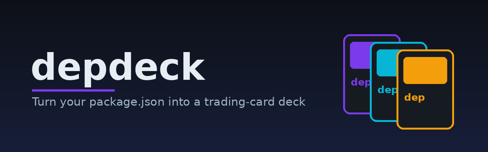
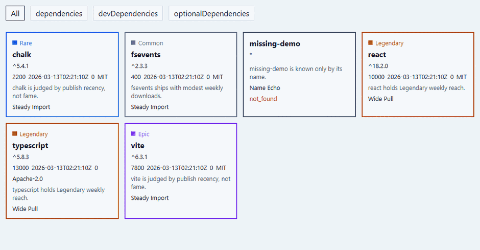

<p align="center"></p>

# Depdeck

Depdeck turns the direct npm dependencies in your `package.json` into trading
cards. Open a self-contained HTML Deck, run a policy Check in CI, or query the
same assessment from an MCP client.



The demo uses offline fixtures. The download counts and publish dates are sample data.

## Install

Build from this checkout with Go 1.26.9 or later. Put Go's bin directory on your
`PATH`, or set `GOBIN` to a directory already on it.

```sh
go install ./cmd/depdeck
depdeck --version
```

Once v1.0.0 is published, download the archive for your OS and architecture from
[GitHub Releases](https://github.com/pragatikumari0927/depdeck/releases), verify
its SHA-256 against `checksums.txt`, and put the extracted executable on your
`PATH`. Archives cover Windows, macOS, and Linux on amd64 and arm64.

```sh
go install github.com/pragatikumari0927/depdeck/cmd/depdeck@v1.0.0
```

Once the Homebrew tap is published, macOS users can build the tagged source with
`brew install pragatikumari0927/tap/depdeck`.

## Scan and check

Place flags before the optional project path. The path can name a directory or a
manifest. With no path, Depdeck reads the current directory's `package.json`.

```sh
depdeck scan ./my-app
depdeck scan --out - ./my-app
depdeck scan --flavor none ./my-app
depdeck scan --json ./my-app
depdeck check --json ./my-app
```

The default scan writes `deck.html` beside the manifest. `--json` writes the
assessment to stdout. Both commands support `--no-cache`. Use `rule` or `none`
for Flavor.

| Exit | Meaning |
|---|---|
| `0` | Scan succeeded or Check passed |
| `1` | Check flagged one or more Dependencies |
| `2` | Invalid input, usage, or a local error |
| `3` | Every Dependency in a nonempty Check failed to fetch |

Check flags a successfully fetched Dependency when Chaos exceeds 0.5 or its
license is missing. A degraded Card retains its name, declared version, Tag, and
Fetch errors. Check evaluates those policy rules only. Use your existing
vulnerability scanner for vulnerability checks.

### JSON recipes

```sh
depdeck scan --json | jq '.data.dependencies[] | select(.rarity == "Legendary")'
depdeck check --json | jq '.data.flagged | length'
```

For CI, run `depdeck check` directly or capture its exit status before piping
the result. CLI and MCP share schema `1.1`. Consumers should check the major
version and read the `data` shape for the tool.

### Sample Cards

| Dependency | Tag | Weekly downloads | Rarity | License |
|---|---|---:|---|---|
| `react` | `dependencies` | 10,000 | Legendary | MIT |
| `vite` | `devDependencies` | 7,800 | Epic | MIT |
| `missing-demo` | `optionalDependencies` | Unknown | Unknown | Unknown |

## Connect an MCP client

Register Depdeck as a local stdio server. Use an absolute path to the executable
if the client has a different `PATH`.

```json
{
  "mcpServers": {
    "depdeck": {
      "command": "depdeck",
      "args": ["mcp"]
    }
  }
}
```

- `list_deck` takes `path` and optional `tag` and `flavor`.
- `get_card` takes an npm package `name` and optional `flavor`.
- `check_deck` takes `path` and returns the assessed Dependencies and verdict.

Relative MCP paths resolve from the server process's working directory. Use an
absolute project path when the MCP client starts the server elsewhere.

## Supported scope

v1 reads the root Roster's direct runtime, development, and optional
Dependencies. It queries public npm, selects facts for a published version
compatible with the declared range, and preserves that range in output. Lockfile
resolution, nested workspaces, transitive Dependencies, and private registry
authentication are outside v1.

[Specification](docs/SPEC.md) · [Testing](docs/TESTING.md) ·
[Security](docs/SECURITY.md) · [Release process](docs/RELEASING.md) ·
[Changelog](CHANGELOG.md)

Depdeck is [MIT licensed](LICENSE). See the [third-party notices](THIRD_PARTY_NOTICES.txt)
for bundled components.