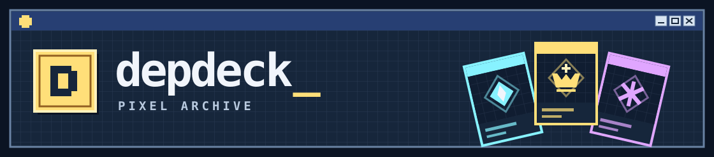
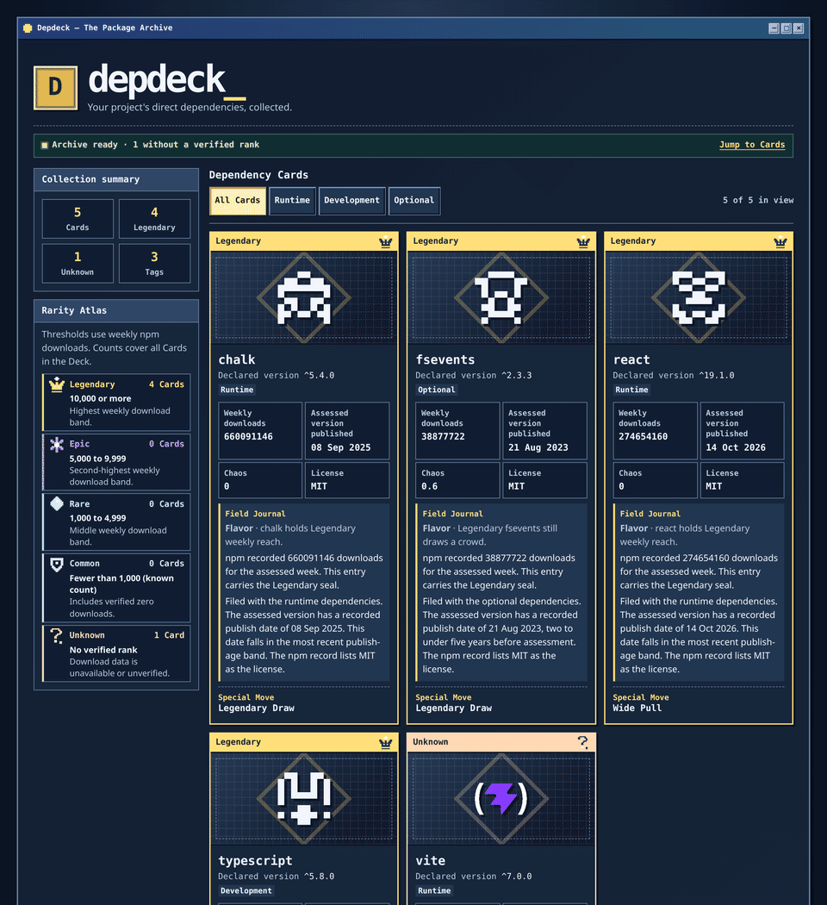
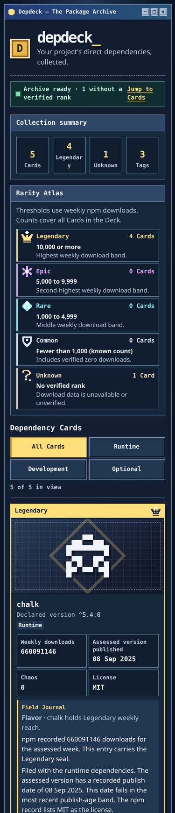
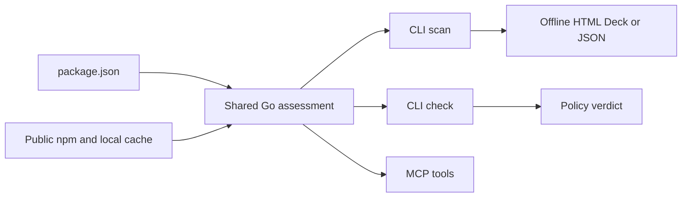
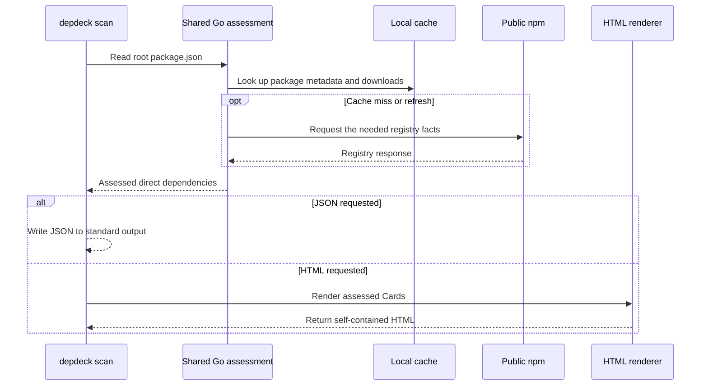

<div align="center">




# depdeck

**Your `package.json` has a secret card collection.**

*Gotta scan ’em all.* Turn the npm packages your project declares into pixel-art Cards. Browse package facts, run a policy Check, or explore the Deck with a coding agent.

[](https://github.com/pragatikumari0927/depdeck/releases) [](https://github.com/pragatikumari0927/depdeck/actions/workflows/test.yml?query=branch%3Amain) [](LICENSE)

</div>

## Peek inside the Pixel Archive



<details>
<summary>See the mobile Deck</summary>



</details>

**This animation shows Pixel Archive on `main`. The published `v1.0.0` release has the earlier Card layout.** It uses an offline fixture: package names, download counts, and dates are sample data. The filters work, and the Rarity Atlas totals stay fixed as the visible Cards change. [Pixel Archive verification results](docs/TESTING.md#pixel-archive-verification)

## Start your collection

### Install the published v1.0.0 release

- **Prebuilt executable.** Choose the archive for Windows, macOS, or Linux and your CPU architecture (`amd64` or `arm64`). Compare its SHA-256 checksum with the matching line in `checksums.txt`. Extract the executable and put it on your `PATH`, the list of directories your terminal searches for programs. [Release archives](https://github.com/pragatikumari0927/depdeck/releases/tag/v1.0.0) · [Checksums](https://github.com/pragatikumari0927/depdeck/releases/download/v1.0.0/checksums.txt)
- **Homebrew on macOS.** Run `brew install pragatikumari0927/tap/depdeck`. [Homebrew tap](https://github.com/pragatikumari0927/homebrew-tap)
- **Go install.** Use a current security patch for your Go line, such as Go 1.26.11 or Go 1.27.4. Run `go install github.com/pragatikumari0927/depdeck/cmd/depdeck@v1.0.0`.

For either Go install in this guide, add the directory from `go env GOBIN` to your `PATH`. If that command returns an empty value, use the `bin` directory under `go env GOPATH`. Run `depdeck --version` to check which executable your shell found.

### Open your first Deck

A JavaScript project’s `package.json` lists its scripts and the packages it uses. A package listed in the root file’s runtime, development, or optional group is a *direct dependency*. npm is the public JavaScript package registry that supplies the package facts.

Run this command from the directory that contains your project’s `package.json`.

```sh
depdeck scan
```

Open `deck.html` beside the manifest. A scan can contact public npm. You can open and filter the saved Deck offline.

### Try the Pixel Archive from main

Pixel Archive landed after the `v1.0.0` tag. Build from the current source with a patched Go toolchain. The minimum is Go 1.26.11.

```sh
git clone https://github.com/pragatikumari0927/depdeck.git
cd depdeck
go install ./cmd/depdeck
```

If you use both builds, install them in separate directories and choose which executable your shell runs.

## Read the Cards

A Card shows the declared version and dependency group, plus the weekly npm downloads, publish date, Chaos, and license when available. **Chaos** scores publish recency. In the Pixel Archive, the **Field Journal** explains the available facts, and rule-based **Flavor** and **Special Moves** add character.

| Rarity seal | Weekly npm downloads |
| --- | --- |
| Legendary | 10,000 or more |
| Epic | 5,000–9,999 |
| Rare | 1,000–4,999 |
| Common | 0–999 |
| Unknown | Download data is unavailable or unverified |

A verified count of zero earns a Common seal. The Rarity Atlas counts the full Deck. The Runtime, Development, and Optional filters change which Cards you see. A failed lookup keeps the Card visible and adds an Archive Notice in the Pixel Archive.

## CLI examples

Run these in your project directory. The optional path can point to a project directory or its `package.json`. Put flags before the path.

```sh
depdeck scan --out ./dependencies.html .
depdeck scan --flavor none .
depdeck scan --json .
depdeck check --json .
```

`--flavor none` omits Flavor and Special Moves. `--json` writes the assessment to standard output and skips HTML generation. Both commands accept `--no-cache` to bypass cache reads and writes. With `jq`, a command-line JSON filter, you can list Legendary package names.

```sh
depdeck scan --json . | jq '.data.dependencies[] | select(.rarity == "Legendary") | .name'
```

After a successful npm fetch, `check` flags a Dependency if its Chaos exceeds 0.5 or its license declaration is missing. A Card with fetch errors keeps those errors for review. In continuous integration (CI), run `depdeck check` directly to use its exit status.

| Exit | Meaning |
| --- | --- |
| `0` | Scan succeeded or Check passed |
| `1` | Check flagged at least one dependency |
| `2` | Invalid input, usage, or a local error |
| `3` | All dependencies in a nonempty Check had fetch errors |

## Connect your coding agent

Model Context Protocol (MCP) lets a coding agent call tools exposed by another
program. depdeck runs as a **local stdio server**: the client starts
`depdeck mcp` and talks to it through standard input and output. It is a
long-running server process, not a command that prints a report and exits.

Install depdeck first, then run `depdeck --version` in the same environment
that starts your agent. If the command is missing, use the
[installation steps above](#start-your-collection). On Windows, check with
`Get-Command depdeck`; on macOS or Linux, use `command -v depdeck`. If your
agent runs in WSL, a container, or a remote workspace, install or locate the
executable inside that environment. Use an absolute executable path when its
PATH cannot find depdeck.

The registration commands below write to the client’s saved configuration.
Check the scope before running one: a user entry applies to your account, and
a project entry may be shared if you commit its configuration file. Review
the command and tool permissions before you approve a server.

### Terminal-first agents

Run the commands for your client, then open a new project session and check
that the depdeck server is connected.

#### Codex CLI

```sh
codex mcp add depdeck -- depdeck mcp
codex mcp list
codex mcp get depdeck
```

This adds a user-scoped server. In Codex CLI or its IDE extension, use `/mcp`
to check for `list_deck`, `get_card`, `check_deck`, and `render_deck`. Remove
the entry with `codex mcp remove depdeck`.

#### Claude Code

```sh
claude mcp add --transport stdio --scope local depdeck -- depdeck mcp
claude mcp list
claude mcp get depdeck
```

The `local` scope is for you in the current project. In a Claude Code session,
use `/mcp` to check the connection. Remove it with
`claude mcp remove --scope local depdeck`.

#### Qoder CLI

```sh
qoder mcp add depdeck -- depdeck mcp
qoder mcp list
```

The default scope is local to the current project. In an open Qoder CLI
session, run `/mcp reload` after adding the server. Remove it with
`qoder mcp remove depdeck`.

#### OpenCode

Run these commands from the project that should use depdeck:

```sh
opencode mcp add depdeck -- depdeck mcp
opencode mcp list
```

OpenCode writes a project configuration. Use `/mcps` in the OpenCode
interface to inspect or reconnect the server. Remove the `depdeck` entry from
that project configuration when you no longer need it.

#### Grok Build CLI

```sh
grok mcp add depdeck -- depdeck mcp
grok mcp list
grok mcp doctor depdeck
```

The default entry is user-scoped. To add it only to the current project, use
`grok mcp add --scope project depdeck -- depdeck mcp` from that project.
Remove it with `grok mcp remove depdeck`.

#### Hermes Agent

```sh
hermes mcp add depdeck --command depdeck --args mcp
hermes mcp list
hermes mcp test depdeck
```

Hermes saves the server in its current profile. Remove it with
`hermes mcp remove depdeck`.

#### Google Antigravity CLI

Open the Antigravity CLI MCP manager with `/mcp`. To configure the local
server by hand, merge the entry below into `mcpServers` in the workspace file
`.agents/mcp_config.json`. The global file is
`~/.gemini/config/mcp_config.json`.

### IDEs and editor agents

Most editors use a JSON configuration. The server entry is usually the same,
but each editor has its own file location and user interface. Merge this
complete example into a file that uses the `mcpServers` format:

```json
{
  "mcpServers": {
    "depdeck": {
      "command": "depdeck",
      "args": ["mcp"]
    }
  }
}
```

Cursor's current stdio entry also requires `"type": "stdio"` inside the
`depdeck` object. Follow the editor's schema when it differs from this common
shape.

On Windows, use the full path to `depdeck.exe` if the editor cannot resolve
your PATH. Escape backslashes in JSON, for example
`"C:\\Tools\\depdeck.exe"`. Do not replace other server entries.

**Client setup map:**

- **Google Antigravity IDE:** Open the Agent panel **… → MCP Servers → Manage MCP Servers → View raw config**. Use the global `~/.gemini/config/mcp_config.json` or workspace `.agents/mcp_config.json`. [Official setup](https://antigravity.google/docs/ide-mcp)
- **Cursor:** Add the entry under `mcpServers` in `.cursor/mcp.json` or `~/.cursor/mcp.json`. Cursor requires `"type": "stdio"` for a local server. [Cursor MCP guide](https://cursor.com/docs/mcp)
- **Kiro IDE:** Enable MCP in Settings and run **Kiro: Open workspace MCP config (JSON)** from the Command Palette. Use `.kiro/settings/mcp.json`; user config is `~/.kiro/settings/mcp.json`. [Kiro configuration](https://kiro.dev/docs/mcp/configuration/)
- **Qoder IDE:** Open **Qoder IDE Settings → MCP → My Servers → + Add**, then choose STDIO and enter `depdeck` with argument `mcp`. [Qoder MCP guide](https://docs.qoder.com/user-guide/chat/model-context-protocol)
- **GitHub Copilot in VS Code:** Run **MCP: Add Server** and choose **Command (stdio)**. Copilot Global is personal; workspace `.mcp.json` may be shared. [VS Code MCP guide](https://code.visualstudio.com/docs/agent-customization/mcp-servers)
- **JetBrains AI Assistant:** Open **Settings → Tools → AI Assistant → Model Context Protocol (MCP)**, add a server, choose **STDIO**, and enter the command and argument. [JetBrains MCP guide](https://www.jetbrains.com/help/ai-assistant/mcp.html)
- **Zed:** Open **Settings → AI → MCP Servers → Add Server → Add Local Server**. Enter command `depdeck` and argument `mcp`; Zed stores it under `context_servers`. [Zed MCP guide](https://zed.dev/docs/ai/mcp)
- **Cline:** Open the extension's **MCP Servers** panel and add a local stdio server with command `depdeck` and argument `mcp`. [Cline MCP guide](https://docs.cline.bot/mcp/mcp-overview)
- **Claude Desktop:** Open **Settings → Developer → Edit Config**, merge the server into `mcpServers`, and restart the app. [Local server guide](https://modelcontextprotocol.io/docs/develop/connect-local-servers)
- **Windsurf Cascade:** Its former MCP documentation currently redirects to Devin Local docs, so setup details can depend on your installed version. See the [note in the full guide](docs/guides/mcp-setup.md#more-desktop-clients).

See the [full MCP setup guide](docs/guides/mcp-setup.md) for platform paths,
absolute executable examples, other clients, removal steps, and troubleshooting.

### Ask your agent to set it up

Choose either prompt. The short version is quick to paste. The detailed version gives the agent more setup context. Both ask the agent to show the proposed configuration and get your approval before saving it.

#### Short prompt

```text
Connect this client to depdeck's local stdio MCP server. Check `depdeck --version`; if it is missing, show me install steps but do not install anything.
Before saving configuration, show me the exact command or file path and scope, preserve other servers, and ask for my approval.
After approval, configure depdeck, reload the client, and verify `list_deck`, `get_card`, `check_deck`, and `render_deck`.
```

#### Detailed prompt

```text
Connect this coding agent to depdeck as a local stdio MCP server. First identify
which client and operating system are running, and where this client starts
child processes. Check whether `depdeck --version` works there. If it does not,
show me the verified install steps; do not install software yet.

Use the depdeck README's "Connect your coding agent" section and
docs/guides/mcp-setup.md to choose the correct setup for this client. Before
changing a configuration, show me the exact command or file path and tell me
whether it is user-scoped or project-scoped. Ask before writing any persistent
configuration. Keep existing servers. Use an absolute executable path if PATH
does not resolve depdeck.

After I approve the setup, configure only the depdeck entry, reload the client,
and verify that list_deck, get_card, check_deck, and render_deck are available.
Explain that list_deck, check_deck, and render_deck need a project path, while
get_card looks up one npm package independently. Do not change project files or
install dependencies.
```

### Try these prompts after connecting

- **Project overview:** “Use depdeck's `list_deck` with the absolute path to this project's root. Summarize its direct dependencies by runtime, development, and optional group. Separate unavailable npm facts from known values.”
- **One package:** “Use depdeck's `get_card` for `react`. Summarize the npm facts it returns. Do not infer that the package is declared in this project.”
- **Policy check:** “Use depdeck's `check_deck` with the absolute path to this project's root. Explain the default publish-age and license-declaration policy results. Report Fetch errors separately; do not describe them as vulnerabilities or policy flags.”
- **Pixel Archive:** “Use depdeck's `render_deck` for this project with `out` set to `depdeck.html`. If that file already exists, stop and ask me before choosing another output path. Tell me the relative path and Card count.”

### Know what the tools do

| Tool | Input | What it tells you |
| --- | --- | --- |
| `list_deck` | Project directory or `package.json` path | Assesses direct dependencies from the root manifest. |
| `get_card` | npm package name | Looks up one public npm package; it does not establish project membership. |
| `check_deck` | Project directory or `package.json` path | Evaluates the default publish-age and license-declaration policy. |
| `render_deck` | Project directory or `package.json` path; optional relative output | Creates the canonical self-contained Pixel Archive HTML under the project. It does not overwrite files; npm data may be fetched. |

The published **v1.0.0** MCP server has the original three assessment tools
and does not include `render_deck`. The Pixel Archive renderer and this tool
are on `main`. To use them through MCP, install the executable from current
`main` and update the command in your MCP client to that executable. Restart
the client and verify the tool list again. See the
[source build steps](docs/guides/mcp-setup.md#install-depdeck-first).

Rarity measures weekly downloads. Chaos reflects publish age. Neither is a
vulnerability score. A Fetch error means npm facts were unavailable or
unverified; it is not proof that a package is risky. Scans may contact the
public npm registry. The saved HTML Deck remains offline. For MCP schema and
tool details, see the [MCP contract](docs/SPEC.md#mcp-surface).


## Under the cartridge



`get_card` looks up one npm package directly. It needs no project manifest.

<details>
<summary>Follow a scan from manifest to Deck</summary>



</details>

## Scope and project links

- Depdeck reads direct dependencies from the root manifest. Lockfile resolution, workspace traversal, transitive dependencies, and private registry authentication are outside its scope.
- Rarity measures weekly downloads and Chaos scores publish recency. Use dedicated tools for vulnerability scanning and license compliance.
- License and publish date describe the published version selected for the declared npm range. They can differ from the version installed on your machine.
- Depdeck reads package data without installing dependencies or running package scripts. Use `rule` or `none` for Flavor. `ai` returns an error.

[Contributing](CONTRIBUTING.md) · [Development](docs/DEVELOPMENT.md) · [Documentation map](docs/README.md) · [Specification](docs/SPEC.md) · [Architecture decisions](docs/DECISIONS.md) · [Testing](docs/TESTING.md)

Report suspected vulnerabilities privately. [Security reporting guide](docs/SECURITY.md#reporting)

[Release notes](RELEASE_NOTES.md) · [Release process](docs/RELEASING.md) · [Changelog](CHANGELOG.md)

[MIT license](LICENSE) · [Third-party notices](THIRD_PARTY_NOTICES.txt)
