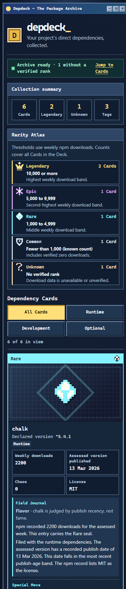

# Testing

Use the Go version in `go.mod`. Run tests without network access. Tests must use local fixtures or an HTTP test server. Do not depend on live npm data.

## Checks

Run these commands from the repository root:

```sh
go test ./...
go vet ./...
go test -race ./...
```

Run the race check where the Go toolchain and compiler support it. Record any platform limit. Run the repository lint and security checks described in [DEVELOPMENT.md](DEVELOPMENT.md) and [SECURITY.md](SECURITY.md).

## Acceptance coverage

- Parser: valid and invalid manifests, omitted and empty fields, unsupported declarations, and size limits.
- Cache: round trips, expiry, corruption, bounded reads, and write failures.
- Registry: semver selection compatible with common npm ranges, malformed data, timeouts, redirects, body limits, and fetch errors.
- Pipeline: all check outcomes and incomplete assessments, with a fixed clock and no network dependency.
- CLI: current-directory default, exit codes, stdout and stderr separation, JSON envelope, HTML output, and write failures.
- MCP: all three tools, schema major-version use, structured content, tool errors, and a preserved assessment when npm fetch fails.
- HTML: hostile package names and versions do not create markup or script.

For each ticket, record commands and results in its completion notes. Do not claim a check passed if it did not run.

## Pixel Archive verification

The Pixel Archive feature branch was verified on 2026-11-14 with Go 1.27.4,
Node 24.19.0, and Chromium 157 on Windows. The race suite used WSL Linux
and GCC 16.2.0. The executable read a seeded cache based on the six-card
Pixel Archive v2 reference. The fixture values are sample npm facts.

| Check | Result |
| --- | --- |
| `go test -json ./... -count=1` | 11 packages and 162 tests and subtests passed, with zero skips. Includes renderer, CLI process, and MCP tests. |
| `go test -race ./... -count=1` | All 11 packages passed under WSL Linux. |
| `go vet ./...`, `golangci-lint run ./...`, `go mod verify`, `git diff --check` | Passed. golangci-lint 2.14.0 reported zero issues. |
| `node --test scripts/codex-go-checks.test.cjs scripts/deck-filter.test.cjs` | Four tests passed. |
| Built CLI and MCP stdio | CLI `scan` and `check` data matched MCP `list_deck` and `check_deck`. `get_card` preserved its standalone shape. The degraded Card retained its structured `not_found` error. |
| Browser, local HTML file | All five seals rendered. Atlas counts were 2 / 1 / 1 / 1 / 1 across all Tag filters. The Field Journal and Archive Notice matched the fixture facts. Hostile names, versions, and license strings stayed inert. The Deck made zero external requests. |
| Responsive layout | No horizontal overflow at 320, 390, 768, 1024, or 1440 px. Keyboard focus, reduced motion, forced colors, and the accessibility tree were checked in Chromium. |
| Determinism and size | Repeated CLI renders were byte-identical. The six-Card Deck was 31,685 bytes. The 47-Card CLI stress fixture was 96,372 bytes, and the repository size fixture was 107,101 bytes. Both 47-Card files were below 150,000 bytes. |

The CLI process suite also covers a successful package lookup followed by a
downloads 404 or 500 and a registry record dated in the future. It checks
the HTML messages and the original JSON error kinds and publish date.

Run the text enlargement regression with Node 24 and Chromium. Pass a local
CLI-generated Deck containing at least one assessed Card and one degraded
Card with an Archive Notice.

```sh
node scripts/verify-deck-reflow.cjs /path/to/chromium /path/to/deck.html
```

Chromium passed at 100% and 200% root text size at all five viewport widths.
The test checks document and content overflow and rejects external requests.

The [desktop screenshot](assets/pixel-archive-desktop.png) and
[mobile screenshot](assets/pixel-archive-mobile.png) are crops of the
CLI-generated Deck. The implementation uses shared tier artwork, an Atlas
with text counts, alphabetical Card order, and the Go rules for Flavor and
Special Moves. The prototype used per-package illustrations, count bars,
a fixed example order, and sample copy. Browser verification covered Chromium.
Firefox, Safari, and screen readers were outside this run.


